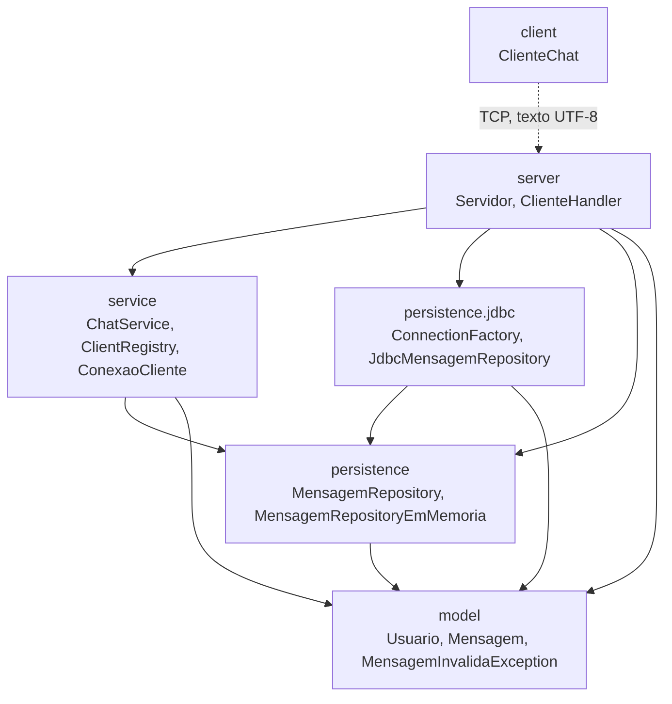
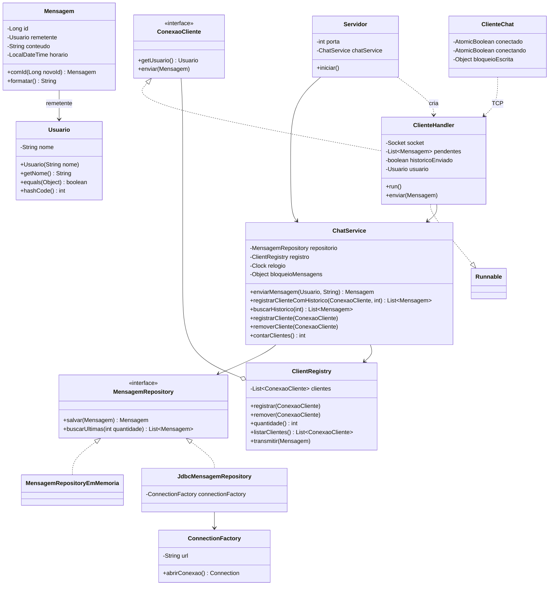
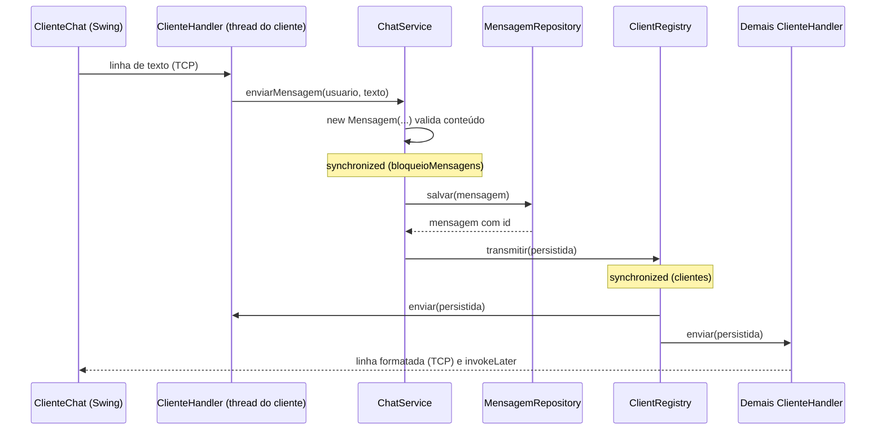
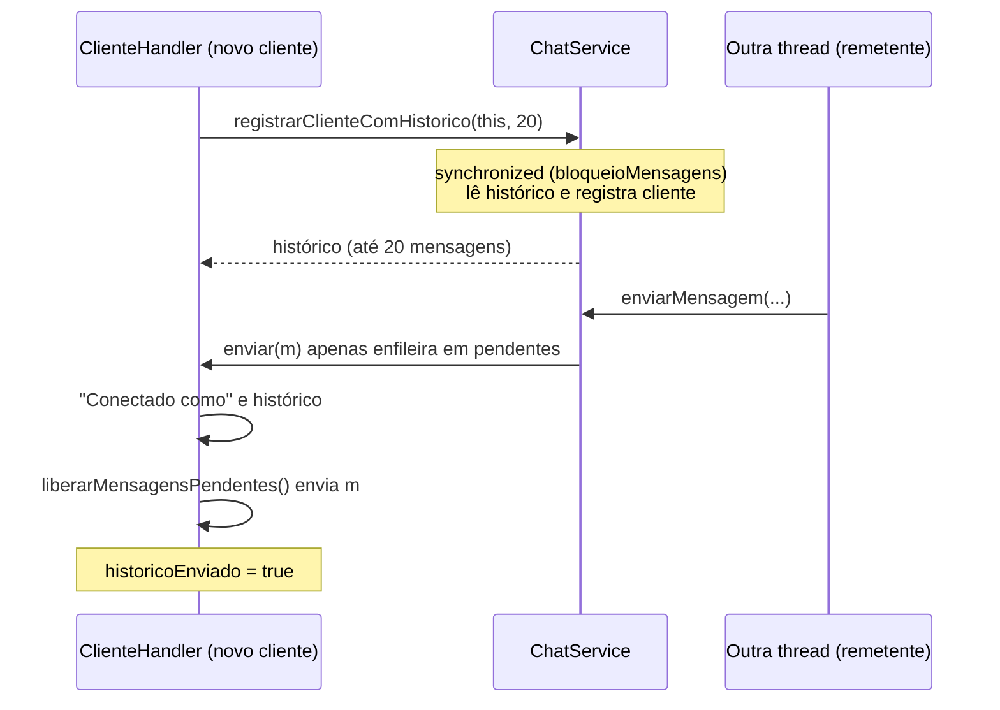

# Relatório Técnico — Chat Sakura

## 1. Introdução e objetivo

O **Chat Sakura** é um sistema de chat multiusuário com histórico persistente, desenvolvido como projeto acadêmico em Java 17. Ele é composto por um servidor TCP, que atende vários clientes de forma simultânea, e por um cliente com interface gráfica Swing.

O objetivo do sistema é permitir que vários usuários troquem mensagens em tempo real. Toda mensagem aceita é gravada em um banco SQLite antes de ser distribuída, e as mensagens mais recentes são apresentadas a cada usuário que se conecta.

A versão final acrescenta, sobre essa base:
- contas com senha;
- conversas privadas e grupos;
- uma barra lateral de conversas no estilo dos mensageiros atuais;
- avatares de perfil;
- a **Sakura IA**: conversas com personagens personalizados interpretados por um modelo **Qwen**.

As seções 1 a 15 descrevem o núcleo concorrente, e a seção 16 descreve essa evolução.

Além da funcionalidade, o projeto tem como objetivo didático demonstrar, de forma correta e verificável:

- programação concorrente com uma thread por conexão;
- sincronização de objetos compartilhados entre threads;
- persistência com JDBC;
- separação de responsabilidades em camadas;
- testes automatizados, inclusive de concorrência.

## 2. Tecnologias utilizadas

| Tecnologia | Uso no projeto |
|---|---|
| Java 17 | Linguagem e plataforma (`maven.compiler.release = 17`). Usa recursos como *text blocks*, `record` (nos testes) e *pattern matching* em `instanceof`. |
| Maven | Gerenciamento de dependências, compilação e execução dos testes (`maven-compiler-plugin` 3.13.0, `maven-surefire-plugin` 3.5.2). |
| Sockets TCP | `ServerSocket` no servidor e `Socket` no cliente, com troca de linhas de texto em UTF-8. |
| Threads | Uma thread por cliente no servidor. No cliente Swing, threads auxiliares para a conexão e para o envio. |
| JDBC | Acesso ao banco por `Connection`, `PreparedStatement` e `ResultSet`. |
| SQLite | Banco embarcado em arquivo (`org.xerial:sqlite-jdbc` 3.46.1.3). |
| Swing | Interface gráfica do cliente, com o tema visual "Sakura" em tons de rosa. |
| JUnit 5 | Testes automatizados (`junit-jupiter` 5.11.4). |
| Gson 2.11.0 | JSON do protocolo v2 e das chamadas ao Qwen (`com.google.code.gson:gson`). |
| `javax.crypto` | Hash de senhas com PBKDF2-HMAC-SHA256 (JDK, sem dependência). |
| `java.net.http.HttpClient` | Chamadas HTTP ao Qwen, feitas somente pelo servidor (JDK, sem dependência). |

Nenhum framework adicional é utilizado. As dependências externas são o driver SQLite e a Gson, além do JUnit, que fica restrito ao escopo de teste.

## 3. Arquitetura em camadas

O código está em `src/main/java/br/unicesumar/chat`, dividido nos pacotes abaixo.

| Pacote | Camada | Classes | Responsabilidade |
|---|---|---|---|
| `model` | Domínio | `Usuario`, `Mensagem`, `MensagemInvalidaException` | Entidades e regras de validação. Não depende de rede, de JDBC nem de arquivos (não importa `java.io` nem `java.sql`). |
| `persistence` | Persistência (contrato) | `MensagemRepository`, `MensagemRepositoryEmMemoria` | Contrato de armazenamento e implementação em memória, thread-safe. |
| `persistence.jdbc` | Persistência (JDBC) | `ConnectionFactory`, `JdbcMensagemRepository` | Implementação do repositório com SQLite. |
| `service` | Regras de negócio | `ChatService`, `ClientRegistry`, `ConexaoCliente` | Envio de mensagens, broadcast, registro de clientes e controle de concorrência. |
| `server` | Servidor | `Servidor`, `ClienteHandler` | Aceitação de conexões TCP e protocolo com cada cliente. |
| `client` | Cliente | `ClienteChat` | Interface Swing e comunicação com o servidor. |

### Relação com o `AGENTS.md`

O `AGENTS.md` define as camadas `domain`, `persistence`, `server` e `client`. No projeto:

- o papel de `domain` é exercido pelo pacote `model`;
- foi incluída uma camada `service`, que concentra as regras de negócio e a sincronização. Com isso, o servidor fica restrito à comunicação de rede, e as regras podem ser testadas sem sockets.

Trata-se de uma diferença de nomenclatura e de granularidade, sem violação de nenhum requisito.

A interface `ConexaoCliente`, do pacote `service`, abstrai o destinatário de uma mensagem. O `ChatService` não conhece sockets: ele apenas chama `enviar(Mensagem)`. Essa abstração permite testar o broadcast com clientes simulados.

## 4. Diagrama de pacotes

O diagrama mostra as dependências de compilação reais entre os pacotes. Cada seta indica que o pacote de origem importa classes do pacote de destino.



O pacote `client` não importa nenhuma classe dos demais pacotes. Ele se comunica com o servidor exclusivamente pelo protocolo de texto via TCP.

## 5. Diagrama das classes principais



### Imutabilidade do domínio

`Mensagem` e `Usuario` são classes `final` com todos os campos `final`. O id de uma mensagem é atribuído pelo método `comId(Long)`, que **cria uma nova instância** em vez de alterar a existente.

Como `LocalDateTime` também é imutável, uma mensagem pode ser compartilhada entre várias threads sem sincronização.

## 6. Fluxo completo de uma mensagem

1. **Recebimento.** No cliente, `ClienteChat.enviarMensagem()` verifica se o texto não está vazio e se tem no máximo 500 caracteres. Em seguida, uma thread auxiliar (`sakura-envio`) escreve a linha no socket.
2. **Leitura no servidor.** A thread do `ClienteHandler` daquele cliente lê a linha com `readLine()` e remove espaços nas extremidades. Linhas vazias são ignoradas, e `/sair` encerra a sessão.
3. **Validação.** `ChatService.enviarMensagem(usuario, texto)` constrói uma `Mensagem` com o horário obtido do `Clock` injetado. O construtor de `Mensagem` rejeita conteúdo nulo, em branco ou com mais de 500 caracteres, lançando `MensagemInvalidaException`. Nesse caso o handler responde `SISTEMA: Mensagem inválida: ...`, e nada é gravado nem distribuído.
4. **Persistência.** Dentro de `synchronized (bloqueioMensagens)`, o serviço chama `repositorio.salvar(mensagem)`, que devolve uma nova instância já com o id gerado pelo banco. Se a gravação falhar, uma `IllegalStateException` é propagada, o broadcast **não ocorre** e o remetente recebe `SISTEMA: Não foi possível salvar a mensagem.`.
5. **Broadcast.** Ainda dentro do mesmo bloqueio, o serviço chama `registro.transmitir(persistida)`, que envia a mensagem a todos os clientes conectados, inclusive o remetente.
6. **Exibição.** Cada `ClienteHandler` escreve a linha formatada (`[dd/MM HH:mm] Nome: texto`). No cliente, a thread de leitura recebe a linha e a acrescenta à área de mensagens por meio de `SwingUtilities.invokeLater`.



## 7. Servidor multithread e `ClienteHandler`

`Servidor.iniciar()` abre um `ServerSocket` na porta `12345`, dentro de um *try-with-resources*, e executa um laço infinito de `accept()`. Para cada conexão aceita, o servidor cria um `ClienteHandler` e o inicia em uma **nova thread**, chamada `chat-cliente-<porta remota>`. A thread principal volta imediatamente a aguardar novas conexões.

`ClienteHandler` implementa `Runnable` e também `ConexaoCliente`. O método `run()` executa o protocolo da sessão:

1. Envia `SISTEMA: Bem-vindo ao Chat Sakura!` e `SISTEMA: Informe seu nome de usuário:`.
2. Lê o nome e cria um `Usuario`. Se o nome for inválido, responde `SISTEMA: Nome inválido: ...` e encerra a conexão.
3. Chama `chatService.registrarClienteComHistorico(this, 20)`. Se o nome já estiver em uso, responde `SISTEMA: Não foi possível entrar: ...`. Se o histórico não puder ser carregado, responde `SISTEMA: Não foi possível carregar o histórico.`. Nos dois casos a conexão é encerrada.
4. Envia `SISTEMA: Conectado como <nome>`, o bloco de histórico (entre `===== HISTÓRICO RECENTE =====` e `===== FIM DO HISTÓRICO =====`) e, em seguida, as mensagens que chegaram durante a conexão (ver seção 10).
5. Entra no laço de leitura das mensagens do usuário.
6. No bloco `finally`, remove o cliente do registro, se ele chegou a ser registrado, e fecha o socket.

Todas as escritas no socket passam pelo método `synchronized enviarLinha`, que escreve a linha e executa `flush()`. Assim, linhas escritas pela própria thread do handler e linhas escritas por threads de outros clientes, durante o broadcast, nunca se intercalam no meio de uma linha.

## 8. Objetos compartilhados entre threads

| Objeto | Threads que o acessam | Proteção |
|---|---|---|
| `ChatService` (uma instância) | Todas as threads `chat-cliente-*` | Seções críticas em `synchronized (bloqueioMensagens)` |
| `ClientRegistry.clientes` | Threads que registram, removem e transmitem | `Collections.synchronizedList` com todo acesso em `synchronized (clientes)` |
| `MensagemRepository` | Chamado pelo `ChatService` | Chamadas serializadas pelo `bloqueioMensagens`. A versão em memória também tem métodos `synchronized`. |
| Canal de saída de cada `ClienteHandler` | Thread do próprio handler e threads que fazem broadcast | Monitor do próprio handler (`enviarLinha` e `enviar` são `synchronized`) |
| `pendentes` e `historicoEnviado` do handler | Mesmas threads do item anterior | Monitor do próprio handler |
| `Mensagem` e `Usuario` | Todas as threads | Imutáveis, dispensam sincronização |
| Estado do cliente Swing (`conectado`, `conectando`, `socket`, `saida`) | Thread do Swing (EDT), `sakura-conexao` e `sakura-envio` | `AtomicBoolean`, campos `volatile` e `synchronized (bloqueioEscrita)` |

## 9. Estratégias de sincronização

### 9.1 `bloqueioMensagens` (em `ChatService`)

`bloqueioMensagens` é um `Object` privado usado como monitor. Duas operações são executadas sob esse bloqueio.

- **`enviarMensagem`:** grava a mensagem e faz o broadcast. Como a gravação e o envio ocorrem na mesma seção crítica, a ordem dos ids no banco é exatamente a ordem em que as mensagens chegam a todos os clientes. Duas mensagens simultâneas nunca são entregues em ordens diferentes para clientes diferentes.
- **`registrarClienteComHistorico`:** lê o histórico e registra o cliente. Como usa o mesmo bloqueio de `enviarMensagem`, nenhuma mensagem pode ser gravada entre a leitura do histórico e o registro do cliente.

### 9.2 `synchronized (clientes)` (em `ClientRegistry`)

A lista de clientes é criada com `Collections.synchronizedList(new ArrayList<>())`, cujo monitor interno é a própria lista. Todos os métodos do registro (`registrar`, `remover`, `quantidade`, `listarClientes` e `transmitir`) acessam a lista dentro de `synchronized (clientes)`.

O método `transmitir(Mensagem)` percorre a lista **dentro** desse bloco, conforme a regra 7 do `AGENTS.md`. Isso garante que nenhum cliente seja incluído ou removido no meio da iteração.

Cada envio fica dentro de um `try/catch` próprio. A falha de um cliente apenas registra uma mensagem de erro (`Falha no envio para ...`), e os demais continuam recebendo a mensagem, conforme a regra 8.

### 9.3 Monitor de cada `ClienteHandler`

Os métodos `enviarLinha`, `enviar` e `liberarMensagensPendentes` são `synchronized` no próprio handler. Isso serializa as escritas no socket daquele cliente e protege a fila de mensagens pendentes.

### 9.4 Ordem de aquisição dos bloqueios e ausência de deadlock

Os bloqueios são sempre adquiridos na mesma ordem:

```text
bloqueioMensagens  →  clientes  →  monitor do ClienteHandler
```

| Operação | Bloqueios adquiridos (em ordem) |
|---|---|
| `enviarMensagem` | `bloqueioMensagens` → `clientes` → monitor de cada handler |
| `registrarClienteComHistorico` | `bloqueioMensagens` → `clientes` |
| `removerCliente` | apenas `clientes` |
| Envio de confirmação, histórico e pendentes pelo handler | apenas o monitor do handler |

Nenhuma thread adquire um bloqueio "anterior" enquanto segura um "posterior". Em particular, o handler nunca chama o `ChatService` enquanto segura o próprio monitor. Como não há aquisição em ordem inversa, não existe espera circular e, portanto, não há possibilidade de deadlock.

### 9.5 Cliente Swing

No cliente, `conectado` e `conectando` são `AtomicBoolean`. O `compareAndSet` impede duas tentativas de conexão simultâneas. As escritas no socket são serializadas por `synchronized (bloqueioEscrita)`.

Toda alteração de componentes Swing feita fora da thread do Swing (EDT), em `adicionarMensagem` e `atualizarEstado`, é encaminhada com `SwingUtilities.invokeLater`, conforme a regra 10.

## 10. Exemplo de *race condition* e sua prevenção

### 10.1 Condição de corrida identificada na conexão

Na versão anterior do `ClienteHandler`, a conexão seguia esta ordem:

1. `registrarCliente(this)`: a partir daqui o cliente já recebia broadcasts;
2. envio de `SISTEMA: Conectado como ...`;
3. `buscarHistorico(20)` e envio do histórico.

Como outra thread podia executar `enviarMensagem` entre essas etapas, havia três falhas possíveis:

| Intercalação | Efeito |
|---|---|
| Broadcast entre as etapas 1 e 2 | A primeira linha após o nome deixava de ser a confirmação. O `ClienteChat` exige que essa linha comece com `SISTEMA: Conectado como `, então tratava a conexão como recusada e desconectava. |
| Mensagem gravada antes da etapa 3 e transmitida ao novo cliente | A mensagem aparecia duas vezes: ao vivo e no histórico. |
| Broadcast antes do bloco de histórico | Mensagem nova exibida antes das antigas, ou seja, fora de ordem. |

### 10.2 Correção

A correção combina dois mecanismos.

1. **Atomicidade no serviço.** `ChatService.registrarClienteComHistorico` lê o histórico e registra o cliente sob `bloqueioMensagens`. Assim, cada mensagem está no histórico devolvido **ou** é entregue por broadcast, nunca nas duas formas e nunca em nenhuma.
2. **Fila de pendentes no handler.** Enquanto `historicoEnviado` é `false`, o método `enviar` apenas acrescenta a mensagem à lista `pendentes`, sem escrever no socket. O handler então envia a confirmação e o histórico, escritos diretamente por `enviarLinha`. Em seguida, `liberarMensagensPendentes()` envia as mensagens da fila na ordem de chegada e marca `historicoEnviado = true`. A partir daí, os broadcasts são escritos diretamente.

Como enfileirar não envolve I/O, um cliente que está se conectando não atrasa o broadcast para os demais.



A correção é comprovada pelos testes `ClienteHandlerTest.deveEnviarConfirmacaoEHistoricoAntesDeBroadcastRecebidoNaConexao` e `HistoricoConexaoConcorrenteTest.clientesQueEntramDuranteBroadcastNaoPerdemNemDuplicamMensagens` (seção 15).

### 10.3 Outro exemplo: "verificar e depois agir" nos nomes

Se a verificação de nome duplicado e a inclusão na lista fossem operações separadas, duas threads poderiam verificar o nome "Ana" ao mesmo tempo. As duas concluiriam que ele está livre e as duas o incluiriam. A prevenção está descrita na seção 11.

## 11. Tratamento de nomes de usuário duplicados

`Usuario.equals` compara nomes **sem diferenciar maiúsculas de minúsculas**, e `hashCode` usa o nome em minúsculas (`Locale.ROOT`). Assim, "Ana" e "ana" são considerados o mesmo usuário.

Em `ClientRegistry.registrar`, a busca por um nome igual e o `add` ocorrem no **mesmo bloco** `synchronized (clientes)`. Portanto, a verificação e a inclusão são atômicas.

Se o nome já estiver em uso, é lançada uma `IllegalArgumentException`. O handler responde `SISTEMA: Não foi possível entrar: Já existe um usuário conectado com esse nome.` e encerra a conexão.

Quando um usuário se desconecta, o `finally` do handler o remove do registro, e o nome volta a ficar disponível.

A classe `Usuario` também valida o nome: ele é obrigatório, tem no máximo 30 caracteres e não pode conter espaços. O cliente Swing repete essas validações antes de conectar.

## 12. Persistência JDBC e histórico

### 12.1 Esquema SQLite

A tabela é criada pelo próprio `JdbcMensagemRepository`, no construtor, com `CREATE TABLE IF NOT EXISTS`:

```sql
CREATE TABLE IF NOT EXISTS mensagem (
    id INTEGER PRIMARY KEY AUTOINCREMENT,
    remetente TEXT NOT NULL,
    texto TEXT NOT NULL,
    horario TEXT NOT NULL
)
```

| Coluna | Conteúdo |
|---|---|
| `id` | Identificador gerado pelo SQLite (`AUTOINCREMENT`), crescente na ordem de inserção |
| `remetente` | Nome do usuário |
| `texto` | Conteúdo da mensagem (no máximo 500 caracteres, validado no domínio) |
| `horario` | `LocalDateTime` em formato ISO-8601 (por exemplo, `2026-11-03T15:00`) |

O servidor utiliza o arquivo `chat-sakura.db`, criado no diretório de trabalho em que o servidor é executado. Esse arquivo é ignorado pelo Git (`*.db` no `.gitignore`).

O script [sql/criar_tabelas.sql](sql/criar_tabelas.sql) contém a mesma tabela e, além dela, um índice em `horario`, que **não** é criado pelo código (ver seção 17).

### 12.2 Conexões

`ConnectionFactory` monta a URL `jdbc:sqlite:<caminho>` e abre uma nova conexão a cada operação, por meio de `DriverManager.getConnection`. O driver é carregado automaticamente (JDBC 4).

Cada método do repositório declara a conexão, o comando e o `ResultSet` em *try-with-resources*, de modo que todos são fechados ao final da operação, inclusive em caso de exceção. Toda `SQLException` é convertida em `IllegalStateException`, preservando a causa original.

### 12.3 Gravação e geração de ids

`salvar` rejeita mensagens que já têm id e executa um `INSERT` com três parâmetros vinculados (`remetente`, `texto`, `horario`). O id gerado é obtido de uma destas formas:

- por `getGeneratedKeys()`;
- de forma alternativa, por `SELECT last_insert_rowid()` **na mesma conexão**, o que garante que o id corresponde ao `INSERT` recém-executado.

O método devolve `mensagem.comId(id)`, uma nova instância imutável.

### 12.4 Recuperação do histórico

`buscarUltimas(quantidade)` rejeita quantidades negativas e devolve uma lista vazia para `0`. Nos demais casos, executa:

```sql
SELECT id, remetente, texto, horario FROM mensagem ORDER BY id DESC LIMIT ?
```

O resultado é invertido com `Collections.reverse`. Assim, o método devolve as `N` mensagens **mais recentes**, em **ordem cronológica crescente**.

A ordenação por `id`, e não por `horario`, é coerente com a ordem real de entrega, pois os ids são gerados dentro do `bloqueioMensagens`, na mesma ordem do broadcast.

Ao conectar, cada cliente recebe as últimas 20 mensagens (`ClienteHandler.QUANTIDADE_HISTORICO`).

### 12.5 Acesso concorrente ao banco

Todas as gravações (`enviarMensagem`) e as leituras de histórico feitas na conexão (`registrarClienteComHistorico`) ocorrem sob `bloqueioMensagens`. Portanto, o servidor nunca executa duas operações concorrentes no SQLite por esses caminhos.

## 13. Uso de `PreparedStatement` e de `Statement`

A regra 9 do `AGENTS.md` exige `PreparedStatement` e *try-with-resources*. No projeto:

| Operação | Recurso | Justificativa |
|---|---|---|
| `salvar`: `INSERT` com remetente, texto e horário | `PreparedStatement` com três parâmetros `?` | Recebe dados fornecidos pelo usuário. Os parâmetros vinculados impedem SQL injection. |
| `buscarUltimas`: `SELECT ... LIMIT ?` | `PreparedStatement` com `setInt` | Operação parametrizada. |
| `inicializarBanco`: `CREATE TABLE IF NOT EXISTS` | `Statement` | SQL fixo, sem nenhum dado externo. |
| Alternativa ao id gerado: `SELECT last_insert_rowid()` | `Statement` | SQL fixo, sem nenhum dado externo, executado na mesma conexão do `INSERT`. |

**Todas as operações que envolvem dados do usuário utilizam `PreparedStatement`**, e nenhum valor é concatenado ao texto SQL.

Os dois usos de `Statement` executam comandos constantes, sem parâmetros. Para eles, `PreparedStatement` não traria ganho de segurança nem de funcionamento. Por essa razão, foram mantidos.

Todos os recursos JDBC, nos quatro casos, são fechados por *try-with-resources*.

## 14. Tratamento de desconexões

| Situação | Comportamento no servidor |
|---|---|
| O usuário envia `/sair` | O laço de leitura termina, e o `finally` remove o cliente e fecha o socket. |
| O usuário clica em **Sair** ou fecha a janela | O cliente fecha o socket, e `readLine()` no servidor retorna `null` ou lança `IOException`. Em seguida, o mesmo `finally` é executado. |
| Encerramento abrupto (processo finalizado, queda de rede) | `readLine()` lança `IOException` (por exemplo, *connection reset*). A exceção é tratada, registrada no console (`Conexão encerrada: ...`), e o `finally` remove o cliente e fecha o socket. |
| Broadcast para um cliente cuja conexão já caiu | A escrita lança `IOException`, capturada pelo `try/catch` daquele cliente em `ClientRegistry.transmitir`. Os demais clientes continuam recebendo. |

Em todos os casos, apenas a thread daquele cliente é encerrada. O servidor e as demais conexões continuam funcionando. O servidor registra no console a entrada e a saída de cada usuário, com a quantidade de clientes conectados.

No cliente Swing, a perda de conexão é exibida como mensagem `SISTEMA: ...`. Os estados `conectado` e `conectando` são reiniciados, e o botão **Conectar** volta a ficar disponível, o que permite a reconexão.

## 15. Testes automatizados

A suíte da entrega original possuía **306 testes JUnit 5**. Ao fim da Fase 6A (seção 16.12), são **506 testes**, todos aprovados em `mvn clean test`, com 0 falhas e 0 erros.

Nenhum teste usa o banco principal nem a internet:
- os testes de persistência usam arquivos SQLite temporários (`@TempDir`);
- os testes de rede usam o servidor real em uma porta efêmera do *loopback*;
- os testes do Qwen usam um servidor HTTP local (`com.sun.net.httpserver`) que imita a API.

A tabela abaixo mostra as classes de teste do núcleo original. As classes acrescentadas pela evolução do sistema aparecem na seção 16.9.

| Classe de teste | Testes | O que verifica |
|---|---|---|
| `MensagemTest` | 8 | Criação de mensagem válida; rejeição de conteúdo nulo ou em branco, remetente nulo e horário nulo; `equals` e `hashCode`; formatação. |
| `model.ModeloTest` | 10 | Validação de `Usuario` (vazio, com espaços, mais de 30 caracteres, exatamente 30); igualdade sem diferenciar maiúsculas; limite de 500 caracteres; `comId` criando nova instância. |
| `MensagemRepositoryEmMemoriaTest` | 5 | Geração de id; últimas mensagens em ordem; lista devolvida independente; quantidade negativa e quantidade zero. |
| `persistence.JdbcMensagemRepositoryTest` | 4 | Id gerado pelo SQLite; últimas mensagens em ordem cronológica; dados preservados após reabrir o repositório; quantidade negativa. |
| `service.ChatServiceTest` | 8 | Broadcast para todos; isolamento de falha de envio; nome duplicado; persistência antes do broadcast; remoção; falha de persistência impedindo o broadcast; mensagem inválida não gravada nem distribuída; limite do histórico. |
| `service.ClientRegistryTest` | 4 | Registro; rejeição de nome duplicado; remoção; cópia independente da lista. |
| `service.BroadcastSincronizacaoTest` | 3 | Cliente removido não recebe novas mensagens; `transmitir` isola a falha de um cliente; registro, remoção e envio simultâneos. |
| `server.ClienteHandlerTest` | 4 | Confirmação e histórico enviados antes de um broadcast recebido durante a conexão, sem duplicação; entrega direta após o histórico; recusa de nome duplicado; falha ao carregar o histórico. |
| `ConcorrenciaTest` | 1 | Gravação concorrente no repositório em memória. |
| `service.ChatConcorrenciaTest` | 3 | Persistência e entrega de mensagens simultâneas; mesma ordem para todos os clientes; registro concorrente do mesmo nome. |
| `service.HistoricoConexaoConcorrenteTest` | 2 | Clientes que entram durante broadcasts; nome duplicado no registro com histórico. |

### 15.1 Testes de concorrência

Todos os testes de concorrência seguem o mesmo padrão, conforme a regra 12:

- as tarefas são submetidas a um `ExecutorService`;
- um `CountDownLatch` libera todas as tarefas ao mesmo tempo, aumentando a disputa;
- o teste espera o término com `shutdown()` e `awaitTermination(30, TimeUnit.SECONDS)`;
- `Future.get()` propaga eventuais exceções das threads;
- não é utilizado `Thread.sleep`.

| Teste | Cenário | Verificação |
|---|---|---|
| `ConcorrenciaTest.deveSalvarTodasAsMensagensConcorrentemente` | 10 threads gravam 100 mensagens cada no repositório em memória | 1.000 mensagens, com ids 1 a 1.000 sem repetição |
| `ChatConcorrenciaTest.devePersistirTodasAsMensagensSimultaneas` | 10 threads enviam 100 mensagens cada, com 3 clientes conectados | 1.000 mensagens gravadas e entregues a cada cliente |
| `ChatConcorrenciaTest.devePreservarOrdemDoBroadcast` | 200 envios concorrentes | Dois clientes recebem as mensagens na mesma ordem, com ids crescentes |
| `ChatConcorrenciaTest.deveRegistrarApenasUmUsuarioComNomeDuplicado` | 20 threads tentam registrar "Ana" | Exatamente 1 registro aceito |
| `HistoricoConexaoConcorrenteTest.clientesQueEntramDuranteBroadcastNaoPerdemNemDuplicamMensagens` | 4 threads enviam 1.000 mensagens enquanto 30 clientes entram | Para cada cliente, histórico seguido das mensagens ao vivo forma ids consecutivos até a última mensagem: sem perda, sem duplicata e em ordem |
| `BroadcastSincronizacaoTest.deveSuportarRegistroRemocaoEEnvioSimultaneos` | 4 threads enviam 800 mensagens enquanto 6 threads fazem 300 ciclos de entrada e saída | Clientes fixos recebem tudo, na mesma ordem; nenhum cliente recebe mensagem após ser removido; contagem final correta |

Para executar os testes:

```bash
mvn clean test
```

## 16. Evolução: contas, conversas, avatares e Sakura IA

### 16.1 Arquitetura cliente-servidor final

```
Cliente Swing (EDT)                         Servidor TCP (uma thread por conexão)
ClienteChat ── ControladorConversas         ClienteHandler ── ChatService (Geral)
   │            (estado das conversas)         │           ├─ ServicoAutenticacao (contas, avatares)
   └─ ConexaoServidor (threads de rede) ⇄ TCP ⇄│           ├─ ServicoConversas (privadas e grupos)
                                               │           └─ ServicoIA ── ProvedorIA ── HTTP ── Qwen
                                               └─ Repositórios JDBC ── SQLite (migrações versionadas)
```

- **Cliente:** não faz rede na EDT. `ConexaoServidor` lê e escreve em threads próprias, e `ControladorConversas` repassa os eventos à interface via `SwingUtilities.invokeLater`.
- **Servidor:** os pacotes continuam separados por camada:
  - `model`: domínio, sem `java.io` nem `java.sql`;
  - `persistence`: repositórios JDBC;
  - `service`: regras de negócio;
  - `server`: TCP;
  - `protocolo`: formato compartilhado entre cliente e servidor;
  - `ia`: provedores de IA.

### 16.2 Autenticação e segurança

- **Contas:** cada conta tem um login único (sem diferenciar maiúsculas), um apelido exibido e um avatar.
- **Senhas:** são protegidas com **PBKDF2-HMAC-SHA256**, com 600.000 iterações, sal aleatório de 16 bytes por conta (`SecureRandom`) e hash de 32 bytes. A comparação é feita em tempo constante.
  - A senha trafega como `char[]` e é apagada após o uso.
  - Login inexistente e senha incorreta recebem a mesma resposta, com o mesmo custo.
- **Identidade:** é definida **pelo servidor** na autenticação e não muda durante a sessão. O servidor ignora qualquer ID de remetente enviado pelo cliente.
- **Personificação:** visitantes e clientes antigos não podem usar o nome de uma conta cadastrada.
- **Limites:** toda linha recebida pelo servidor tem no máximo 4096 caracteres, e o login permite 5 tentativas por conexão.
- **Sigilo nos registros:** nenhum log, evento ou mensagem de erro contém senha, hash, sal ou chave de API.
- **Ressalva:** o PBKDF2 protege as senhas **armazenadas**, mas o tráfego TCP não usa TLS. Por isso o sistema não deve ser exposto publicamente.

### 16.3 Protocolo

- **Handshake:** o servidor envia as linhas de boas-vindas. O cliente legado responde com o apelido; o cliente atualizado responde `SAKURA 2`, e um apelido nunca contém espaço, então não há ambiguidade. Em seguida vem `ENTRAR` ou `CADASTRAR`, com os campos em Base64 URL, e a resposta `AUTH OK` ou `AUTH ERRO`.
- **Protocolo v2:** depois do `AUTH OK`, cada linha é um objeto **JSON estrito** (Gson) com o campo `tipo` e, opcionalmente, `req`, que correlaciona requisição e resposta.
  - Requisições: `LISTAR_CONVERSAS`, `LISTAR_USUARIOS`, `ABRIR_PRIVADA`, `CRIAR_GRUPO`, `ENVIAR`, `HISTORICO`, `MARCAR_LIDA`, `CRIAR_PERSONAGEM` e `DEFINIR_AVATAR`.
  - Eventos: `CONVERSAS`, `CONVERSA`, `USUARIOS`, `HISTORICO`, `MENSAGEM`, `PERFIL`, `IA_STATUS` e `ERRO`.
- **Validação:** tipos, IDs inteiros, tamanhos de texto e listas são validados. JSON inválido gera um evento `ERRO` sem derrubar a sessão.
- **Compatibilidade:** clientes legados e visitantes continuam no protocolo de texto original e recebem **somente** o Chat Geral.

### 16.4 Persistência e migrações

O `MigradorBanco` controla o esquema por `PRAGMA user_version`.

| Versão | Conteúdo |
|---|---|
| 0 | Banco vazio ou legado |
| 1 | Coluna `tipo` na tabela de mensagens |
| 2 | Tabelas `usuario`, `conversa`, `conversa_participante`, `conversa_privada` e `personagem`; mensagens ligadas a uma conversa |
| 3 | `ultima_lida_id`, para o contador de não lidas |

- Antes de migrar um banco existente, é feito um backup consistente com `VACUUM INTO`, conferido com `quick_check`.
- Todas as migrações pendentes rodam em **uma única transação**, com verificação de chaves estrangeiras e de integridade antes do commit. Uma falha desfaz tudo e impede o servidor de iniciar.
- Um banco de versão futura é recusado sem ser alterado.
- As chaves estrangeiras ficam ativas em toda conexão.
- A Sakura IA não exigiu uma nova versão: ela usa as tabelas `personagem`, `conversa` (tipo `IA`) e `mensagem` (tipo `IA`), já previstas na versão 2.

### 16.5 Chat Geral, conversas privadas e grupos

- **Chat Geral:** é a conversa de id 1, aberta a todos.
- **Conversas privadas:** usam um par canônico (menor id, maior id) com restrição `UNIQUE`, então abrir de novo reaproveita a mesma conversa.
- **Grupos:** quem cria é `ADMIN` e os convidados são `MEMBRO`.
- **Autorização:** toda operação fora do Geral exige participação. Conversa inexistente e conversa sem acesso recebem a mesma resposta (`NAO_ENCONTRADA`), para não revelar metadados.
- **Entrega:** `ClientRegistry.transmitirPara` entrega somente às sessões autenticadas dos participantes, percorrendo a lista dentro de `synchronized (clientes)` e isolando falhas.
- **Ordem:** cada conversa tem o próprio bloqueio (gravação e entrega juntas), então conversas independentes não se bloqueiam.
- **Mensagens offline:** quem estava fora encontra as mensagens no histórico; o contador de não lidas é persistido.

### 16.6 Avatares

- **Catálogo:** `CatalogoAvatares` é um catálogo fechado de 6 avatares (flor de cerejeira, lua, gatinho, estrela, onda e xícara de chá), desenhados em **Java2D** a partir do identificador. Não há arquivos externos, upload nem caminhos de arquivo.
- **Validação e gravação:** o servidor valida o identificador e o grava em `usuario.avatar_id`.
- **Atualização:** a mudança é anunciada (`PERFIL`) aos demais clientes.
- **Exibição:** o avatar aparece no cabeçalho, no item das conversas privadas e na galeria.

### 16.7 Integração com o Qwen

- **Interface:** `ProvedorIA` desacopla o serviço do provedor concreto.
- **Provedor real:** `ProvedorQwen` usa a API **compatível com OpenAI** (`POST /chat/completions`) com `java.net.http.HttpClient` e Gson. A mesma implementação atende:
  - à API oficial do Qwen no **Alibaba Cloud Model Studio** (DashScope), que é o padrão, com o modelo `qwen-plus`;
  - ao **Ollama** local (`http://localhost:11434/v1`), com modelos como `qwen2.5:3b`.
- **Configuração:** somente por variáveis de ambiente: `QWEN_API_KEY`, `QWEN_BASE_URL`, `QWEN_MODEL` e `QWEN_TIMEOUT_SEGUNDOS`.
  - Modelos que não sejam da família Qwen são recusados.
  - A chave vai apenas no cabeçalho `Authorization` e nunca aparece em logs, eventos TCP ou mensagens de erro.
- **Limites:**
  - tempo limite configurável (padrão de 45 s);
  - resposta de até 400 tokens;
  - contexto com as 20 mensagens mais recentes, até 6.000 caracteres;
  - 8 gerações por minuto por conta;
  - uma geração por vez em cada conversa;
  - **nenhuma** nova tentativa automática.
- **Erros tratados:** autenticação (401/403), limite de uso (429), modelo ou endereço inexistente (404), indisponibilidade (5xx ou serviço local parado), tempo esgotado e resposta malformada. Cada caso vira uma mensagem clara na conversa.
- **Concorrência:** `ServicoIA` chama o provedor em um executor próprio (threads `sakura-ia-*`), **fora** da EDT, da thread da conexão e de qualquer bloqueio do chat. Geral, privadas e grupos seguem funcionando com a IA lenta ou indisponível.
- **Sem configuração:** o servidor usa `ProvedorIndisponivel`, que informa como configurar o Qwen. Ele **nunca** apresenta respostas simuladas como se fossem do Qwen.
- **Provedor simulado:** `ProvedorIAFalso` gera respostas determinísticas prefixadas com `[SIMULADO]`. É usado nos testes e, de forma explícita, com `CHAT_SAKURA_IA=simulado`.

### 16.8 Personagens personalizados

- **Criação:** o usuário define nome, personalidade (até 400 caracteres) e contexto (até 1.200).
- **Conversa:** o personagem ganha uma conversa do tipo `IA` da qual **somente o dono** participa. Por isso a mesma autorização das demais conversas isola os personagens: outros usuários não listam, não leem e não enviam.
- **Pedido ao Qwen:** o servidor envia as instruções do personagem e o histórico recente **daquela** conversa. As instruções pedem português do Brasil e respostas curtas, mandam manter o personagem, não afirmar ser uma pessoa real e não pedir dados pessoais.
- **Respostas:** são gravadas como mensagens do tipo `IA`, com o nome do personagem como remetente, e divididas se passarem de 500 caracteres.
- **Interface:** a conversa começa com o aviso de que se trata de um personagem interpretado por IA, e o título mostra "digitando…" durante a geração.

### 16.9 Testes da evolução e demonstração

| Classe de teste | O que verifica |
|---|---|
| `MigradorBancoTest` | Migrações 0→3, 1→3 e 2→3; backup em WAL; falha com rollback; versão futura recusada; idempotência; script SQL igual ao esquema |
| `HashSenhaTest`, `ServicoAutenticacaoTest` | Parâmetros PBKDF2; sais distintos; senha incorreta; duplicados; validação; persistência; concorrência; logs sem credenciais |
| `ClienteHandlerAutenticacaoTest`, `ConexaoContasTest` | Handshake; identidade vinculada pelo servidor; personificação; cliente legado; limite de linha; EDT livre |
| `ProtocoloSakuraTest`, `ProtocoloJsonTest` | Codecs, JSON inválido ou não estrito, limites e eventos sem dados sensíveis |
| `ServicoConversasTest`, `ConversasTcpTest` | Privadas sem duplicação, grupos, isolamento de terceiros e de legados, offline, reinício, ordem sob concorrência e avatar via TCP |
| `ProvedorQwenTest` | Requisição no formato do Qwen, interpretação da resposta (inclusive `<think>`), erros 401/403/404/429/5xx, tempo limite, serviço parado, configuração e chave fora de logs |
| `ServicoIATest` | Personagens, validação, histórico em ordem, isolamento entre personagens e usuários, falha sem resposta inventada, chat livre durante a geração, limite de uso, geração fora da EDT e avatares |
| `ControladorConversasTest`, `ControladorConversasJsonTest` | Eventos na EDT, barra lateral, não lidas, histórico sem duplicar, aviso de IA, "digitando…", avatares, temas e exportação |

A demonstração prática final usou o servidor real, um SQLite temporário e três janelas reais. As **41 verificações** passaram:
- cadastro e Chat Geral;
- privada isolada de terceiros;
- grupo com os três;
- avatares persistidos e anunciados;
- dois personagens independentes, com o provedor **SIMULADO** lento (2 s) e a interface respondendo em menos de 5 ms durante a geração;
- reconexão;
- reinício do servidor com recuperação de contas, conversas, avatares, personagens e históricos;
- mensagem clara quando o Qwen não está configurado;
- temas Claro e Noturno;
- exportação TXT.

**Qwen real:** na entrega original, a integração foi testada só contra um servidor que imita a API. Depois, ela foi verificada com o modelo `qwen2.5:3b` local pelo Ollama (seção 16.10).

### 16.10 Auditoria técnica e Fases 1 a 4

Depois da entrega, uma auditoria apontou riscos de segurança, estabilidade e qualidade. Eles foram tratados em quatro fases, cada uma com testes automatizados (bancos e certificados temporários, provedores de IA simulados) e uma demonstração com o servidor real.

**Fase 1: robustez do servidor.**
- **Fila de saída por cliente** (`FilaSaida`): limitada e com um único escritor. O broadcast só enfileira, sem fazer I/O dentro de `synchronized (clientes)` ou de `bloqueioMensagens`; um cliente que não lê enche a própria fila e é desconectado, sem atrasar os demais.
- **Vagas e prazos:** limite global e por IP de conexões (`ControleConexoes`), prazo total para concluir a entrada e heartbeat PING/PONG para sessões v2. O cliente legado não precisa de heartbeat.
- **Proteção do login** (`ProtecaoAutenticacao`): falhas limitadas por IP e por login com bloqueio temporário, e cálculos PBKDF2 simultâneos limitados. O algoritmo de hash não mudou.
- **Sessão por conta:** a identidade é o id da conta. Um novo login substitui a sessão anterior, que não consegue mais enviar.
- **Limites de taxa por sessão** (*token bucket*).
- **Isolamento da IA:** a participação na conversa é verificada antes do estado da IA.

**Fase 2: identidade, banco e cliente.**
- **Normalização Unicode** dos nomes (`NormalizacaoNome`: NFKC e minúsculas com `Locale.ROOT`), com recusa de caracteres invisíveis, espaços Unicode e alfabetos misturados.
- **Migração v4:** `apelido_chave` único. Uma colisão interrompe a migração sem alterar contas.
- **SQLite:** WAL, `busy_timeout` e transações `BEGIN IMMEDIATE`, com migração única por inicialização.
- **Cliente:**
  - escritor serial que preserva a ordem dos envios;
  - nova tentativa quando o histórico falha;
  - avisos não modais (`AvisoDiscreto`);
  - reconexão com *backoff* que pede o login de novo, sem guardar a senha, e restaura as conversas.

**Fase 3: inteligência artificial.**
- **Prompt em blocos** (`MontadorPrompt`): identidade, personalidade e contexto como dados delimitados, estilo de fala, memória e regras. O histórico tem só mensagens reais.
- **Orçamento de contexto** que preserva identidade, personalidade e regras.
- **Memória individual por conversa** (migração v5, `memoria_personagem`): resumo a cada 10 mensagens, feito só com as falas do usuário, filtrado contra dados sensíveis e instruções (`FiltroMemoria`). Só o dono pode vê-la ou apagá-la; apagar mantém o histórico.
- **Ollama pela API nativa** (`num_ctx`, `keep_alive` por pedido, `repeat_penalty`), uma geração por vez no modo local, com fila limitada.
- **Respostas truncadas** marcadas com "[…]".

**Fase 4: TLS.**
- **APIs e protocolos:** `ContextoTls`, `TransporteServidor` e `TransporteCliente` usam o JSSE padrão (`SSLContext`, `SSLServerSocket`, `SSLSocket`, `KeyManagerFactory`, `TrustManagerFactory`), somente com TLS 1.3 e 1.2.
- **Certificados:** o servidor carrega certificado e chave de um keystore cuja senha vem do ambiente e é apagada da memória após o uso.
- **Validação no cliente:** cadeia contra o truststore, nome ou IP pelo SAN (identificação de *endpoint* "HTTPS") e datas do certificado, **antes de enviar qualquer dado**.
- **Sem rebaixamento:** nunca há TrustManager permissivo, verificação de nome desligada nem tentativa automática sem TLS.
- **TLS é o padrão:** sem keystore, o servidor não inicia. TCP sem TLS existe apenas com `CHAT_SAKURA_MODO=tcp-desenvolvimento` e escuta só no *loopback*.
- **Handshake no servidor:** acontece antes de qualquer leitura ou escrita, com prazo; uma falha fecha o socket e libera a vaga.
- **Reconexão:** abre nova conexão TLS, valida o certificado de novo e recusa rebaixar para TCP.
- **Demonstração:** um relé local gravou os bytes enviados pelo cliente; neles não aparecem senha (nem em Base64), comandos nem mensagens. Não foi feita captura de pacotes da rede.

**Resultado:** 423 testes automatizados aprovados ao fim da Fase 4.

### 16.11 Fase 5: personalização visual e temas florais

**Paletas.** `PaletasFlorais` calcula, uma única vez, oito paletas: Sakura, Myosotis, Fuji e Suzuran, cada uma em claro e escuro. Sakura Claro e Sakura Escuro são exatamente as paletas originais (`PaletaSakura.CLARO` e `NOTURNO`). As demais partem delas:
- cada papel da paleta recebe o matiz e a saturação da flor, mantendo só parte do desvio de matiz que tinha em relação ao rosa (assim o ameixa do Noturno vira azul-noite, e não verde-água);
- cores de estado (online, aviso, erro) e nomes dos participantes não mudam;
- no modo claro, as cores de referência da flor entram nos papéis principais (destaque, seleção e fundo da janela);
- por fim, cada par de texto e fundo é ajustado até pelo menos 4,5:1.

O modo escuro herda o desenho do Sakura Noturno (sem preto puro, textos claros sem branco puro), em vez de escurecer o claro. Banner e flor do projeto são recoloridos em memória para cada flor; o original não muda.

**Fundos.** `DecoracaoFundo` compõe os três fundos para qualquer paleta: floral (degradê e ilustrações originais da flor, desenhadas em Java2D, só nos cantos e bordas), liso (pastel da paleta) e neutro (sem cor nem decoração). O centro, onde ficam as mensagens, e a faixa do título ficam livres, o que é verificado pixel a pixel nos testes.

**Aplicação sem reiniciar.** `GerenciadorTema` guarda a aparência completa (`Aparencia`: paleta, modo e fundo), troca a paleta na EDT e avisa os componentes, que leem as cores ao pintar. A tela **Aparência** (`DialogoAparencia`) mostra uma prévia (`PreviaAparencia`) pintada com a paleta candidata; nada muda na janela até **Aplicar**.

**Desempenho.**
- As paletas são calculadas uma vez.
- O fundo da conversa fica em cache e só é refeito quando muda o tamanho, a escala, a paleta ou o fundo.
- As flores recoloridas ficam em cache. Dos banners recoloridos (1500 × 500), só os dois mais recentes ficam na memória.
- As pétalas animadas só rodam no fundo floral.

**Preferências por conta.**
- **Servidor:** a migração v6 cria `preferencia_aparencia`, com uma linha por conta e `ON DELETE CASCADE`. O `ServicoPreferencias` usa sempre a conta da sessão autenticada.
- **Protocolo:** `DEFINIR_APARENCIA` é validado estritamente (valor inválido → `DADOS_INVALIDOS`) e entra no balde de criações do limite de taxa. O evento `APARENCIA` é enviado após a entrada e após cada gravação.
- **Valores antigos ou desconhecidos** no banco viram o padrão daquele campo. Falha no banco nunca impede o login.
- **Cliente:**
  - aplica a aparência da conta recebida do servidor;
  - ao sair, volta à aparência local (`~/.chat-sakura/preferencias.properties`, chaves `tema`, `paleta` e `fundo`);
  - na reconexão, mantém a aparência da conta e envia uma escolha feita sem conexão quando a sessão volta.
- **Arquivos antigos**, só com `tema`, abrem em Sakura com fundo floral.

**Demonstração (banco temporário, servidor real em TLS).**
- Sem keystore, o servidor recusou iniciar e nenhum banco foi criado.
- Com TLS, Ana escolheu Fuji / Escuro / Floral e Bia escolheu Myosotis / Claro / Liso. O banco ficou com uma linha por conta, e nenhuma escolha chegou à outra conta.
- Geral, privada e grupo funcionaram, e o Qwen respondeu.
- Após reiniciar o servidor, cada uma recebeu a própria aparência.
- Foram feitas capturas da janela real nas oito combinações.

**Resultado:** 473 testes automatizados aprovados ao fim da Fase 5.

### 16.12 Fase 6A: pesquisa de mensagens e mensagens fixadas

**Pesquisa.**
- **Onde:** o `ServicoMensagens` pesquisa no histórico persistido da conversa pedida.
- **Forma de pesquisa:** a migração v7 acrescenta `mensagem.texto_busca`, calculada em Java por `TextoBusca` (NFKD, sem marcas diacríticas, minúsculas com `Locale.ROOT`, espaços reduzidos) e preenchida para todas as mensagens existentes. O texto original não muda.
- **Consulta:**
  - `instr` sobre a forma de pesquisa, por isso `%` e `_` não são curingas;
  - todos os valores vão como parâmetros do `PreparedStatement`;
  - filtros opcionais de remetente e período;
  - ordem decrescente por id, com paginação por `antesDe` (*keyset*), o que dá páginas estáveis, sem repetições nem lacunas.
- **Tamanho da página:** no máximo 50 itens. O servidor busca um a mais só para indicar se há outra página.
- **Trecho:** o resultado traz um trecho de até 140 caracteres e a posição do termo no texto original, mesmo quando a normalização muda o tamanho do texto.

**Mensagens fixadas.**
- **Armazenamento:** a tabela `mensagem_fixada` tem chave (`conversa_id`, `mensagem_id`). Apagar a mensagem ou a conversa apaga a fixação (`ON DELETE CASCADE`); apagar a conta de quem fixou mantém a fixação sem o autor (`ON DELETE SET NULL`). Há índices em `mensagem_id` e `fixada_por`.
- **Limite de 10 por conversa:** verificado numa transação `BEGIN IMMEDIATE`, que reserva a escrita antes de contar, e sob um bloqueio por conversa. Um teste com dois "servidores" sobre o mesmo arquivo e 24 pedidos simultâneos termina com exatamente 10.
- **Política, sem cargos novos:**
  - privada: qualquer participante;
  - grupo: só o papel ADMIN, já existente;
  - IA: o dono;
  - Geral: ninguém.
- **Aviso aos participantes:** a lista atualizada chega por `FIXADAS` aos demais participantes conectados.

**Acesso.**
- Toda operação exige conta e participação (no Geral, só a conta, pois o histórico já é público).
- Conversa alheia e conversa inexistente têm a mesma resposta (`NAO_ENCONTRADA`).
- Falta de papel responde com o novo código `SEM_PERMISSAO`.
- O cliente esconde as ações não permitidas, mas o servidor verifica de novo cada pedido.

**Cliente.**
- **Painel lateral não modal** (`PainelBuscaFixadas`): pesquisa com filtros e página seguinte, e lista de fixadas. Ele descarta respostas atrasadas de pesquisas ou de conversas anteriores.
- **Balões:** os balões passam a conhecer o id da mensagem, para o item de menu "Fixar mensagem" e o alfinete discreto.
- **Abrir uma mensagem:** destaca a original. Se ela for mais antiga que o histórico carregado, o cliente busca páginas anteriores (até 500 mensagens) e as insere antes das demais, sem lacunas.
- **Rede e temas:** tudo é pedido em segundo plano, e a EDT nunca espera a rede. As cores vêm da paleta ativa nas oito combinações.

**Resultado:** 506 testes automatizados aprovados ao fim da Fase 6A.

## 17. Funcionalidades extras

- **Interface gráfica Swing com tema Sakura.** A janela usa cores em tons de rosa e tem:
  - área de mensagens com rolagem automática;
  - campo de envio (Enter ou botão **Enviar**);
  - botões **Conectar**, **Sair** e **Exportar TXT**;
  - indicador de estado (Desconectado, Conectando..., Conectado como ...);
  - botões habilitados conforme o estado da conexão.
- **Diálogo de conexão.** Solicita nome, endereço do servidor (padrão `localhost`) e porta (padrão `12345`), com validação local. A conexão tem tempo limite de 5 segundos.
- **Exportação para TXT.** O botão **Exportar TXT** abre um `JFileChooser` com o nome sugerido `chat-sakura-AAAA-MM-DD_HH-MM-SS.txt`. A extensão `.txt` é acrescentada, se necessário, e há confirmação antes de substituir um arquivo existente. O conteúdo exibido na janela é gravado em UTF-8.
- **Histórico ao conectar.** As últimas 20 mensagens são exibidas em um bloco delimitado.
- **Mensagens do sistema.** O servidor informa nome inválido, nome em uso, mensagem inválida e falhas de persistência.

## 18. Limitações conhecidas

Várias limitações da entrega original foram resolvidas nas Fases 1 a 4 (seção 16.10): TLS, cliente lento, limite de conexões, tentativas de login por IP e normalização Unicode. As que permanecem:

1. **Certificado autoassinado.** Cada cliente precisa receber o certificado público do servidor. Não há uma autoridade certificadora nem renovação automática.
2. **Clientes legados sem TLS.** Clientes antigos em texto puro só funcionam com o servidor no modo de desenvolvimento.
3. **Qualidade do modelo local.** O `qwen2.5:3b` mantém o tom dos personagens, mas comete erros de português e de fatos; às vezes não usa a memória disponível. Na demonstração da Fase 4, o resumo trocou "gato" por "cachorro", provavelmente induzido pelo exemplo do prompt de resumo. Fica registrado para ajuste numa fase de IA.
4. **Homóglifos de um único alfabeto.** Um nome inteiro em cirílico parecido com um latino ("АНА") é aceito.
5. **Grupos simples.** Não há edição de membros, saída nem exclusão de grupos e personagens.
6. **Não lidas do Chat Geral.** O contador vale apenas durante a sessão; nas demais conversas, ele é persistido.
7. **Horário sem fuso.** O horário é gravado como `LocalDateTime` do relógio do servidor.
8. **Exportação.** O TXT contém a conversa carregada na janela, não o histórico completo do banco.
9. **Aparência.**
   - Diálogos de confirmação e de erro simples (`JOptionPane`) e o seletor de arquivos seguem o visual do sistema, não a paleta.
   - Os nomes dos participantes usam as mesmas cinco cores em todas as paletas.
   - Na Suzuran, o verde do indicador "online" fica próximo do tom da paleta.
   - O logotipo continua sendo a flor de cerejeira, recolorida.
10. **Pesquisa e fixadas.**
    - A pesquisa percorre as mensagens da conversa (sem índice de texto completo). É adequada ao volume de um chat acadêmico, mas ficaria lenta em conversas com centenas de milhares de mensagens.
    - Abrir uma mensagem com mais de 500 mensagens depois dela mostra só o aviso e o trecho.
    - O Chat Geral não tem mensagens fixadas.
    - Não há exclusão de mensagens pela interface; a regra de exclusão vale para o banco (e para uma futura exclusão).

## 19. Melhorias futuras

- Revisar o prompt de resumo da memória (sem exemplo que induza fatos) e medir a qualidade com mais conversas.
- Comando de desligamento ordenado do servidor.
- Respostas da IA por *streaming* e exibição progressiva.
- Edição de grupos (adicionar e remover membros, sair) e exclusão de personagens.
- Autoridade certificadora interna para a rede local, evitando distribuir certificados autoassinados.
- Paginação do histórico na interface (o protocolo já aceita `antesDe`).
- Horário com fuso (`Instant`) e configuração de porta e banco por arquivo de propriedades.

## 20. Conclusão

O Chat Sakura atende aos requisitos originais:
- servidor TCP com uma thread por conexão;
- broadcast dentro de `synchronized (clientes)`, com isolamento de falhas;
- JDBC com `PreparedStatement` e *try-with-resources*;
- interface Swing atualizada pela EDT;
- domínio imutável;
- testes de concorrência com `ExecutorService` e `awaitTermination`.

Sobre essa base, a versão final entrega:
- contas autenticadas com PBKDF2;
- protocolo JSON v2 validado;
- conversas privadas e grupos com autorização em toda operação;
- barra lateral com não lidas;
- avatares persistentes;
- quatro paletas florais em claro e escuro, com três fundos e aparência guardada por conta;
- pesquisa no histórico salvo e mensagens fixadas, com acesso verificado no servidor;
- a Sakura IA com personagens personalizados e histórico próprio, integrada ao **Qwen** por uma interface desacoplada.

As garantias de concorrência continuam valendo: as conversas têm bloqueios independentes, a IA roda fora de qualquer bloqueio e a EDT nunca faz rede. Os 506 testes automatizados e as demonstrações práticas de cada fase sustentam essas afirmações. As limitações acima indicam a evolução natural do projeto, sem alterar a arquitetura em camadas.
