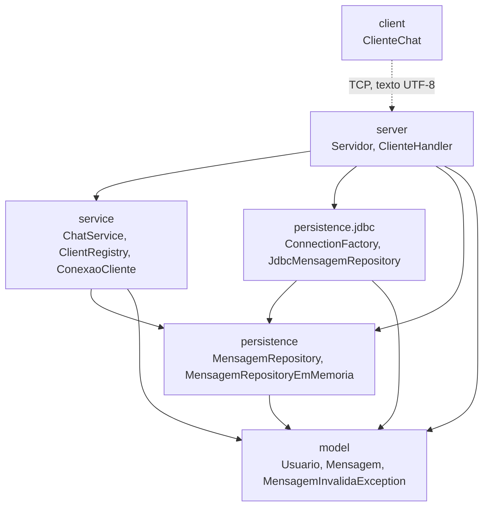
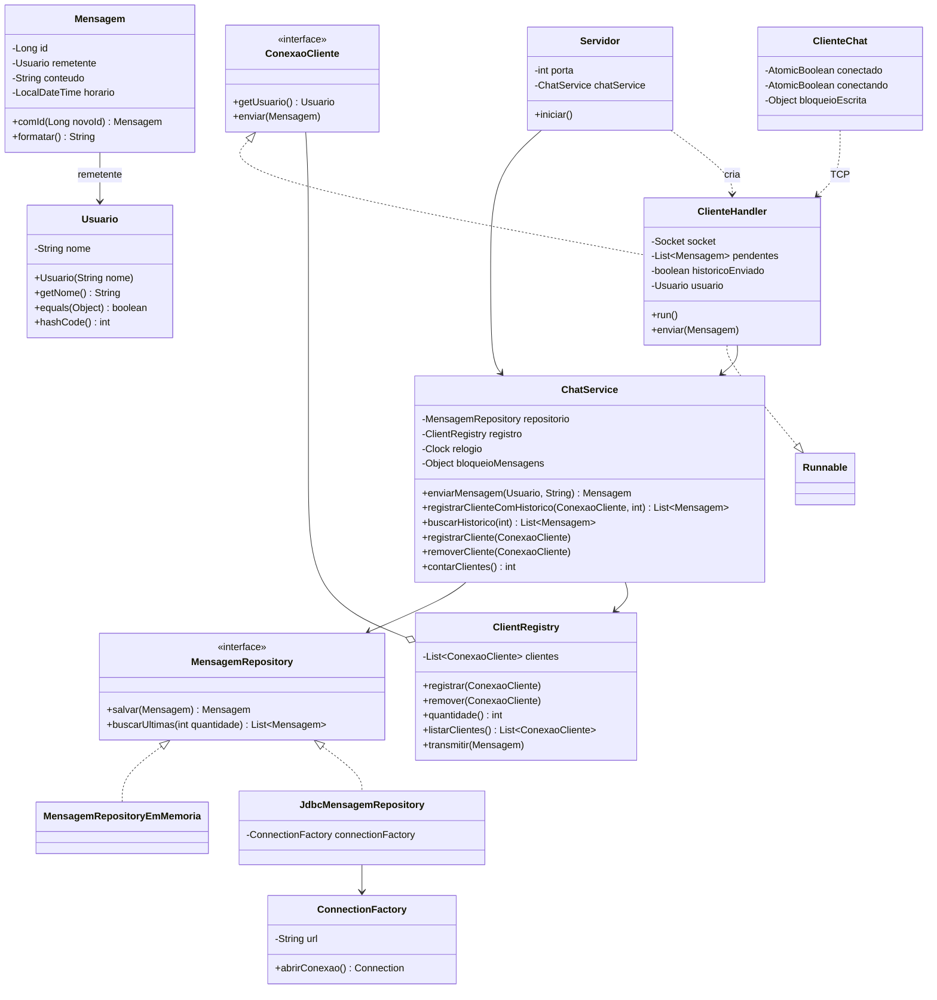
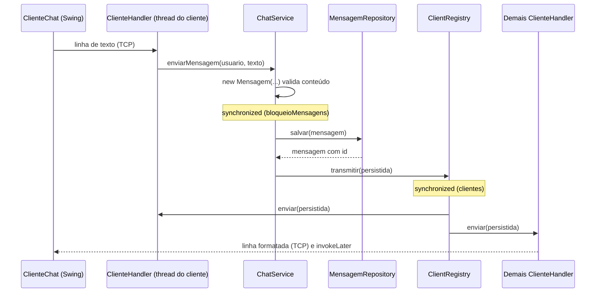
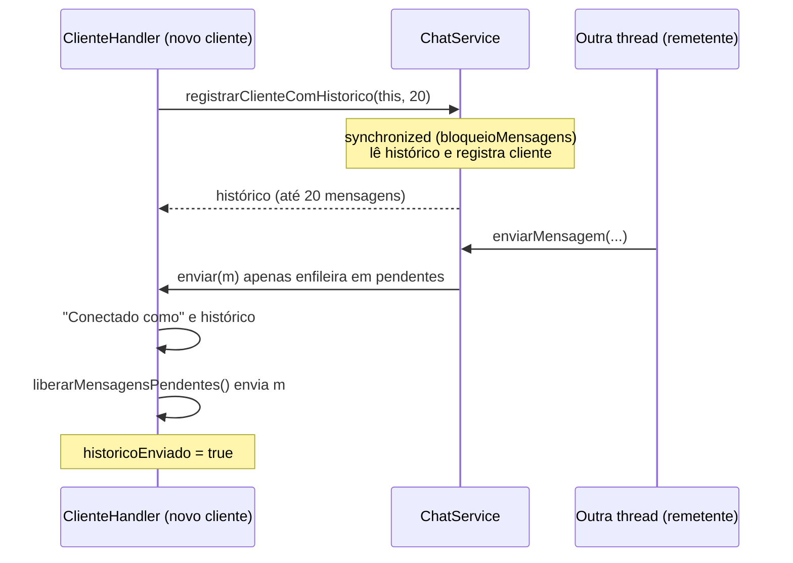

# Relatório Técnico — Chat Sakura

## 1. Introdução e objetivo

O **Chat Sakura** é um sistema de chat multiusuário com histórico persistente, desenvolvido como projeto acadêmico em Java 17. Ele é composto por um servidor TCP, que atende vários clientes de forma simultânea, e por um cliente com interface gráfica Swing.

O objetivo do sistema é permitir que vários usuários, identificados por nome, troquem mensagens em tempo real. Toda mensagem aceita é gravada em um banco SQLite antes de ser distribuída, e as mensagens mais recentes são apresentadas a cada usuário que se conecta.

Além da funcionalidade, o projeto tem como objetivo didático demonstrar, de forma correta e verificável:

- programação concorrente com uma thread por conexão;
- sincronização de objetos compartilhados entre threads;
- persistência com JDBC;
- separação de responsabilidades em camadas;
- testes automatizados, inclusive de concorrência.

## 2. Tecnologias utilizadas

| Tecnologia | Uso no projeto |
|---|---|
| Java 17 | Linguagem e plataforma (`maven.compiler.release = 17`). Usa recursos como *text blocks*, `record` (nos testes) e *pattern matching* em `instanceof`. |
| Maven | Gerenciamento de dependências, compilação e execução dos testes (`maven-compiler-plugin` 3.13.0, `maven-surefire-plugin` 3.5.2). |
| Sockets TCP | `ServerSocket` no servidor e `Socket` no cliente, com troca de linhas de texto em UTF-8. |
| Threads | Uma thread por cliente no servidor. No cliente Swing, threads auxiliares para a conexão e para o envio. |
| JDBC | Acesso ao banco por `Connection`, `PreparedStatement` e `ResultSet`. |
| SQLite | Banco embarcado em arquivo (`org.xerial:sqlite-jdbc` 3.46.1.3). |
| Swing | Interface gráfica do cliente, com o tema visual "Sakura" em tons de rosa. |
| JUnit 5 | Testes automatizados (`junit-jupiter` 5.11.4). |

Nenhum framework adicional é utilizado. As únicas dependências são o driver SQLite e o JUnit, este último restrito ao escopo de teste.

## 3. Arquitetura em camadas

O código está em `src/main/java/br/unicesumar/chat`, dividido nos pacotes abaixo.

| Pacote | Camada | Classes | Responsabilidade |
|---|---|---|---|
| `model` | Domínio | `Usuario`, `Mensagem`, `MensagemInvalidaException` | Entidades e regras de validação. Não depende de rede, de JDBC nem de arquivos (não importa `java.io` nem `java.sql`). |
| `persistence` | Persistência (contrato) | `MensagemRepository`, `MensagemRepositoryEmMemoria` | Contrato de armazenamento e implementação em memória, thread-safe. |
| `persistence.jdbc` | Persistência (JDBC) | `ConnectionFactory`, `JdbcMensagemRepository` | Implementação do repositório com SQLite. |
| `service` | Regras de negócio | `ChatService`, `ClientRegistry`, `ConexaoCliente` | Envio de mensagens, broadcast, registro de clientes e controle de concorrência. |
| `server` | Servidor | `Servidor`, `ClienteHandler` | Aceitação de conexões TCP e protocolo com cada cliente. |
| `client` | Cliente | `ClienteChat` | Interface Swing e comunicação com o servidor. |

### Relação com o `AGENTS.md`

O `AGENTS.md` define as camadas `domain`, `persistence`, `server` e `client`. No projeto:

- o papel de `domain` é exercido pelo pacote `model`;
- foi incluída uma camada `service`, que concentra as regras de negócio e a sincronização. Com isso, o servidor fica restrito à comunicação de rede, e as regras podem ser testadas sem sockets.

Trata-se de uma diferença de nomenclatura e de granularidade, sem violação de nenhum requisito.

A interface `ConexaoCliente`, do pacote `service`, abstrai o destinatário de uma mensagem. O `ChatService` não conhece sockets: ele apenas chama `enviar(Mensagem)`. Essa abstração permite testar o broadcast com clientes simulados.

## 4. Diagrama de pacotes

O diagrama mostra as dependências de compilação reais entre os pacotes. Cada seta indica que o pacote de origem importa classes do pacote de destino.



O pacote `client` não importa nenhuma classe dos demais pacotes. Ele se comunica com o servidor exclusivamente pelo protocolo de texto via TCP.

## 5. Diagrama das classes principais



### Imutabilidade do domínio

`Mensagem` e `Usuario` são classes `final` com todos os campos `final`. O id de uma mensagem é atribuído pelo método `comId(Long)`, que **cria uma nova instância** em vez de alterar a existente.

Como `LocalDateTime` também é imutável, uma mensagem pode ser compartilhada entre várias threads sem sincronização.

## 6. Fluxo completo de uma mensagem

1. **Recebimento.** No cliente, `ClienteChat.enviarMensagem()` verifica se o texto não está vazio e se tem no máximo 500 caracteres. Em seguida, uma thread auxiliar (`sakura-envio`) escreve a linha no socket.
2. **Leitura no servidor.** A thread do `ClienteHandler` daquele cliente lê a linha com `readLine()` e remove espaços nas extremidades. Linhas vazias são ignoradas, e `/sair` encerra a sessão.
3. **Validação.** `ChatService.enviarMensagem(usuario, texto)` constrói uma `Mensagem` com o horário obtido do `Clock` injetado. O construtor de `Mensagem` rejeita conteúdo nulo, em branco ou com mais de 500 caracteres, lançando `MensagemInvalidaException`. Nesse caso o handler responde `SISTEMA: Mensagem inválida: ...`, e nada é gravado nem distribuído.
4. **Persistência.** Dentro de `synchronized (bloqueioMensagens)`, o serviço chama `repositorio.salvar(mensagem)`, que devolve uma nova instância já com o id gerado pelo banco. Se a gravação falhar, uma `IllegalStateException` é propagada, o broadcast **não ocorre** e o remetente recebe `SISTEMA: Não foi possível salvar a mensagem.`.
5. **Broadcast.** Ainda dentro do mesmo bloqueio, o serviço chama `registro.transmitir(persistida)`, que envia a mensagem a todos os clientes conectados, inclusive o remetente.
6. **Exibição.** Cada `ClienteHandler` escreve a linha formatada (`[dd/MM HH:mm] Nome: texto`). No cliente, a thread de leitura recebe a linha e a acrescenta à área de mensagens por meio de `SwingUtilities.invokeLater`.



## 7. Servidor multithread e `ClienteHandler`

`Servidor.iniciar()` abre um `ServerSocket` na porta `12345`, dentro de um *try-with-resources*, e executa um laço infinito de `accept()`. Para cada conexão aceita, o servidor cria um `ClienteHandler` e o inicia em uma **nova thread**, chamada `chat-cliente-<porta remota>`. A thread principal volta imediatamente a aguardar novas conexões.

`ClienteHandler` implementa `Runnable` e também `ConexaoCliente`. O método `run()` executa o protocolo da sessão:

1. Envia `SISTEMA: Bem-vindo ao Chat Sakura!` e `SISTEMA: Informe seu nome de usuário:`.
2. Lê o nome e cria um `Usuario`. Se o nome for inválido, responde `SISTEMA: Nome inválido: ...` e encerra a conexão.
3. Chama `chatService.registrarClienteComHistorico(this, 20)`. Se o nome já estiver em uso, responde `SISTEMA: Não foi possível entrar: ...`. Se o histórico não puder ser carregado, responde `SISTEMA: Não foi possível carregar o histórico.`. Nos dois casos a conexão é encerrada.
4. Envia `SISTEMA: Conectado como <nome>`, o bloco de histórico (entre `===== HISTÓRICO RECENTE =====` e `===== FIM DO HISTÓRICO =====`) e, em seguida, as mensagens que chegaram durante a conexão (ver seção 10).
5. Entra no laço de leitura das mensagens do usuário.
6. No bloco `finally`, remove o cliente do registro, se ele chegou a ser registrado, e fecha o socket.

Todas as escritas no socket passam pelo método `synchronized enviarLinha`, que escreve a linha e executa `flush()`. Assim, linhas escritas pela própria thread do handler e linhas escritas por threads de outros clientes, durante o broadcast, nunca se intercalam no meio de uma linha.

## 8. Objetos compartilhados entre threads

| Objeto | Threads que o acessam | Proteção |
|---|---|---|
| `ChatService` (uma instância) | Todas as threads `chat-cliente-*` | Seções críticas em `synchronized (bloqueioMensagens)` |
| `ClientRegistry.clientes` | Threads que registram, removem e transmitem | `Collections.synchronizedList` com todo acesso em `synchronized (clientes)` |
| `MensagemRepository` | Chamado pelo `ChatService` | Chamadas serializadas pelo `bloqueioMensagens`. A versão em memória também tem métodos `synchronized`. |
| Canal de saída de cada `ClienteHandler` | Thread do próprio handler e threads que fazem broadcast | Monitor do próprio handler (`enviarLinha` e `enviar` são `synchronized`) |
| `pendentes` e `historicoEnviado` do handler | Mesmas threads do item anterior | Monitor do próprio handler |
| `Mensagem` e `Usuario` | Todas as threads | Imutáveis, dispensam sincronização |
| Estado do cliente Swing (`conectado`, `conectando`, `socket`, `saida`) | Thread do Swing (EDT), `sakura-conexao` e `sakura-envio` | `AtomicBoolean`, campos `volatile` e `synchronized (bloqueioEscrita)` |

## 9. Estratégias de sincronização

### 9.1 `bloqueioMensagens` (em `ChatService`)

`bloqueioMensagens` é um `Object` privado usado como monitor. Duas operações são executadas sob esse bloqueio.

- **`enviarMensagem`:** grava a mensagem e faz o broadcast. Como a gravação e o envio ocorrem na mesma seção crítica, a ordem dos ids no banco é exatamente a ordem em que as mensagens chegam a todos os clientes. Duas mensagens simultâneas nunca são entregues em ordens diferentes para clientes diferentes.
- **`registrarClienteComHistorico`:** lê o histórico e registra o cliente. Como usa o mesmo bloqueio de `enviarMensagem`, nenhuma mensagem pode ser gravada entre a leitura do histórico e o registro do cliente.

### 9.2 `synchronized (clientes)` (em `ClientRegistry`)

A lista de clientes é criada com `Collections.synchronizedList(new ArrayList<>())`, cujo monitor interno é a própria lista. Todos os métodos do registro (`registrar`, `remover`, `quantidade`, `listarClientes` e `transmitir`) acessam a lista dentro de `synchronized (clientes)`.

O método `transmitir(Mensagem)` percorre a lista **dentro** desse bloco, conforme a regra 7 do `AGENTS.md`. Isso garante que nenhum cliente seja incluído ou removido no meio da iteração.

Cada envio fica dentro de um `try/catch` próprio. A falha de um cliente apenas registra uma mensagem de erro (`Falha no envio para ...`), e os demais continuam recebendo a mensagem, conforme a regra 8.

### 9.3 Monitor de cada `ClienteHandler`

Os métodos `enviarLinha`, `enviar` e `liberarMensagensPendentes` são `synchronized` no próprio handler. Isso serializa as escritas no socket daquele cliente e protege a fila de mensagens pendentes.

### 9.4 Ordem de aquisição dos bloqueios e ausência de deadlock

Os bloqueios são sempre adquiridos na mesma ordem:

```text
bloqueioMensagens  →  clientes  →  monitor do ClienteHandler
```

| Operação | Bloqueios adquiridos (em ordem) |
|---|---|
| `enviarMensagem` | `bloqueioMensagens` → `clientes` → monitor de cada handler |
| `registrarClienteComHistorico` | `bloqueioMensagens` → `clientes` |
| `removerCliente` | apenas `clientes` |
| Envio de confirmação, histórico e pendentes pelo handler | apenas o monitor do handler |

Nenhuma thread adquire um bloqueio "anterior" enquanto segura um "posterior". Em particular, o handler nunca chama o `ChatService` enquanto segura o próprio monitor. Como não há aquisição em ordem inversa, não existe espera circular e, portanto, não há possibilidade de deadlock.

### 9.5 Cliente Swing

No cliente, `conectado` e `conectando` são `AtomicBoolean`. O `compareAndSet` impede duas tentativas de conexão simultâneas. As escritas no socket são serializadas por `synchronized (bloqueioEscrita)`.

Toda alteração de componentes Swing feita fora da thread do Swing (EDT), em `adicionarMensagem` e `atualizarEstado`, é encaminhada com `SwingUtilities.invokeLater`, conforme a regra 10.

## 10. Exemplo de *race condition* e sua prevenção

### 10.1 Condição de corrida identificada na conexão

Na versão anterior do `ClienteHandler`, a conexão seguia esta ordem:

1. `registrarCliente(this)`: a partir daqui o cliente já recebia broadcasts;
2. envio de `SISTEMA: Conectado como ...`;
3. `buscarHistorico(20)` e envio do histórico.

Como outra thread podia executar `enviarMensagem` entre essas etapas, havia três falhas possíveis:

| Intercalação | Efeito |
|---|---|
| Broadcast entre as etapas 1 e 2 | A primeira linha após o nome deixava de ser a confirmação. O `ClienteChat` exige que essa linha comece com `SISTEMA: Conectado como `, então tratava a conexão como recusada e desconectava. |
| Mensagem gravada antes da etapa 3 e transmitida ao novo cliente | A mensagem aparecia duas vezes: ao vivo e no histórico. |
| Broadcast antes do bloco de histórico | Mensagem nova exibida antes das antigas, ou seja, fora de ordem. |

### 10.2 Correção

A correção combina dois mecanismos.

1. **Atomicidade no serviço.** `ChatService.registrarClienteComHistorico` lê o histórico e registra o cliente sob `bloqueioMensagens`. Assim, cada mensagem está no histórico devolvido **ou** é entregue por broadcast, nunca nas duas formas e nunca em nenhuma.
2. **Fila de pendentes no handler.** Enquanto `historicoEnviado` é `false`, o método `enviar` apenas acrescenta a mensagem à lista `pendentes`, sem escrever no socket. O handler então envia a confirmação e o histórico, escritos diretamente por `enviarLinha`. Em seguida, `liberarMensagensPendentes()` envia as mensagens da fila na ordem de chegada e marca `historicoEnviado = true`. A partir daí, os broadcasts são escritos diretamente.

Como enfileirar não envolve I/O, um cliente que está se conectando não atrasa o broadcast para os demais.



A correção é comprovada pelos testes `ClienteHandlerTest.deveEnviarConfirmacaoEHistoricoAntesDeBroadcastRecebidoNaConexao` e `HistoricoConexaoConcorrenteTest.clientesQueEntramDuranteBroadcastNaoPerdemNemDuplicamMensagens` (seção 15).

### 10.3 Outro exemplo: "verificar e depois agir" nos nomes

Se a verificação de nome duplicado e a inclusão na lista fossem operações separadas, duas threads poderiam verificar o nome "Ana" ao mesmo tempo. As duas concluiriam que ele está livre e as duas o incluiriam. A prevenção está descrita na seção 11.

## 11. Tratamento de nomes de usuário duplicados

`Usuario.equals` compara nomes **sem diferenciar maiúsculas de minúsculas**, e `hashCode` usa o nome em minúsculas (`Locale.ROOT`). Assim, "Ana" e "ana" são considerados o mesmo usuário.

Em `ClientRegistry.registrar`, a busca por um nome igual e o `add` ocorrem no **mesmo bloco** `synchronized (clientes)`. Portanto, a verificação e a inclusão são atômicas.

Se o nome já estiver em uso, é lançada uma `IllegalArgumentException`. O handler responde `SISTEMA: Não foi possível entrar: Já existe um usuário conectado com esse nome.` e encerra a conexão.

Quando um usuário se desconecta, o `finally` do handler o remove do registro, e o nome volta a ficar disponível.

A classe `Usuario` também valida o nome: ele é obrigatório, tem no máximo 30 caracteres e não pode conter espaços. O cliente Swing repete essas validações antes de conectar.

## 12. Persistência JDBC e histórico

### 12.1 Esquema SQLite

A tabela é criada pelo próprio `JdbcMensagemRepository`, no construtor, com `CREATE TABLE IF NOT EXISTS`:

```sql
CREATE TABLE IF NOT EXISTS mensagem (
    id INTEGER PRIMARY KEY AUTOINCREMENT,
    remetente TEXT NOT NULL,
    texto TEXT NOT NULL,
    horario TEXT NOT NULL
)
```

| Coluna | Conteúdo |
|---|---|
| `id` | Identificador gerado pelo SQLite (`AUTOINCREMENT`), crescente na ordem de inserção |
| `remetente` | Nome do usuário |
| `texto` | Conteúdo da mensagem (no máximo 500 caracteres, validado no domínio) |
| `horario` | `LocalDateTime` em formato ISO-8601 (por exemplo, `2026-11-03T15:00`) |

O servidor utiliza o arquivo `chat-sakura.db`, criado no diretório de trabalho em que o servidor é executado. Esse arquivo é ignorado pelo Git (`*.db` no `.gitignore`).

O script [sql/criar_tabelas.sql](sql/criar_tabelas.sql) contém a mesma tabela e, além dela, um índice em `horario`, que **não** é criado pelo código (ver seção 17).

### 12.2 Conexões

`ConnectionFactory` monta a URL `jdbc:sqlite:<caminho>` e abre uma nova conexão a cada operação, por meio de `DriverManager.getConnection`. O driver é carregado automaticamente (JDBC 4).

Cada método do repositório declara a conexão, o comando e o `ResultSet` em *try-with-resources*, de modo que todos são fechados ao final da operação, inclusive em caso de exceção. Toda `SQLException` é convertida em `IllegalStateException`, preservando a causa original.

### 12.3 Gravação e geração de ids

`salvar` rejeita mensagens que já têm id e executa um `INSERT` com três parâmetros vinculados (`remetente`, `texto`, `horario`). O id gerado é obtido de uma destas formas:

- por `getGeneratedKeys()`;
- de forma alternativa, por `SELECT last_insert_rowid()` **na mesma conexão**, o que garante que o id corresponde ao `INSERT` recém-executado.

O método devolve `mensagem.comId(id)`, uma nova instância imutável.

### 12.4 Recuperação do histórico

`buscarUltimas(quantidade)` rejeita quantidades negativas e devolve uma lista vazia para `0`. Nos demais casos, executa:

```sql
SELECT id, remetente, texto, horario FROM mensagem ORDER BY id DESC LIMIT ?
```

O resultado é invertido com `Collections.reverse`. Assim, o método devolve as `N` mensagens **mais recentes**, em **ordem cronológica crescente**.

A ordenação por `id`, e não por `horario`, é coerente com a ordem real de entrega, pois os ids são gerados dentro do `bloqueioMensagens`, na mesma ordem do broadcast.

Ao conectar, cada cliente recebe as últimas 20 mensagens (`ClienteHandler.QUANTIDADE_HISTORICO`).

### 12.5 Acesso concorrente ao banco

Todas as gravações (`enviarMensagem`) e as leituras de histórico feitas na conexão (`registrarClienteComHistorico`) ocorrem sob `bloqueioMensagens`. Portanto, o servidor nunca executa duas operações concorrentes no SQLite por esses caminhos.

## 13. Uso de `PreparedStatement` e de `Statement`

A regra 9 do `AGENTS.md` exige `PreparedStatement` e *try-with-resources*. No projeto:

| Operação | Recurso | Justificativa |
|---|---|---|
| `salvar`: `INSERT` com remetente, texto e horário | `PreparedStatement` com três parâmetros `?` | Recebe dados fornecidos pelo usuário. Os parâmetros vinculados impedem SQL injection. |
| `buscarUltimas`: `SELECT ... LIMIT ?` | `PreparedStatement` com `setInt` | Operação parametrizada. |
| `inicializarBanco`: `CREATE TABLE IF NOT EXISTS` | `Statement` | SQL fixo, sem nenhum dado externo. |
| Alternativa ao id gerado: `SELECT last_insert_rowid()` | `Statement` | SQL fixo, sem nenhum dado externo, executado na mesma conexão do `INSERT`. |

**Todas as operações que envolvem dados do usuário utilizam `PreparedStatement`**, e nenhum valor é concatenado ao texto SQL.

Os dois usos de `Statement` executam comandos constantes, sem parâmetros. Para eles, `PreparedStatement` não traria ganho de segurança nem de funcionamento. Por essa razão, foram mantidos.

Todos os recursos JDBC, nos quatro casos, são fechados por *try-with-resources*.

## 14. Tratamento de desconexões

| Situação | Comportamento no servidor |
|---|---|
| O usuário envia `/sair` | O laço de leitura termina, e o `finally` remove o cliente e fecha o socket. |
| O usuário clica em **Sair** ou fecha a janela | O cliente fecha o socket, e `readLine()` no servidor retorna `null` ou lança `IOException`. Em seguida, o mesmo `finally` é executado. |
| Encerramento abrupto (processo finalizado, queda de rede) | `readLine()` lança `IOException` (por exemplo, *connection reset*). A exceção é tratada, registrada no console (`Conexão encerrada: ...`), e o `finally` remove o cliente e fecha o socket. |
| Broadcast para um cliente cuja conexão já caiu | A escrita lança `IOException`, capturada pelo `try/catch` daquele cliente em `ClientRegistry.transmitir`. Os demais clientes continuam recebendo. |

Em todos os casos, apenas a thread daquele cliente é encerrada. O servidor e as demais conexões continuam funcionando. O servidor registra no console a entrada e a saída de cada usuário, com a quantidade de clientes conectados.

No cliente Swing, a perda de conexão é exibida como mensagem `SISTEMA: ...`. Os estados `conectado` e `conectando` são reiniciados, e o botão **Conectar** volta a ficar disponível, o que permite a reconexão.

## 15. Testes automatizados

A suíte possui **52 testes JUnit 5**. Na última execução de `mvn clean test`, os 52 foram aprovados, com 0 falhas e 0 erros.

Com exceção de `JdbcMensagemRepositoryTest`, que usa um arquivo SQLite temporário (`@TempDir`), nenhum teste utiliza banco real ou socket de rede. Os testes do servidor usam um `Socket` simulado, cujos fluxos de entrada e saída ficam em memória.

| Classe de teste | Testes | O que verifica |
|---|---|---|
| `MensagemTest` | 8 | Criação de mensagem válida; rejeição de conteúdo nulo ou em branco, remetente nulo e horário nulo; `equals` e `hashCode`; formatação. |
| `model.ModeloTest` | 10 | Validação de `Usuario` (vazio, com espaços, mais de 30 caracteres, exatamente 30); igualdade sem diferenciar maiúsculas; limite de 500 caracteres; `comId` criando nova instância. |
| `MensagemRepositoryEmMemoriaTest` | 5 | Geração de id; últimas mensagens em ordem; lista devolvida independente; quantidade negativa e quantidade zero. |
| `persistence.JdbcMensagemRepositoryTest` | 4 | Id gerado pelo SQLite; últimas mensagens em ordem cronológica; dados preservados após reabrir o repositório; quantidade negativa. |
| `service.ChatServiceTest` | 8 | Broadcast para todos; isolamento de falha de envio; nome duplicado; persistência antes do broadcast; remoção; falha de persistência impedindo o broadcast; mensagem inválida não gravada nem distribuída; limite do histórico. |
| `service.ClientRegistryTest` | 4 | Registro; rejeição de nome duplicado; remoção; cópia independente da lista. |
| `service.BroadcastSincronizacaoTest` | 3 | Cliente removido não recebe novas mensagens; `transmitir` isola a falha de um cliente; registro, remoção e envio simultâneos. |
| `server.ClienteHandlerTest` | 4 | Confirmação e histórico enviados antes de um broadcast recebido durante a conexão, sem duplicação; entrega direta após o histórico; recusa de nome duplicado; falha ao carregar o histórico. |
| `ConcorrenciaTest` | 1 | Gravação concorrente no repositório em memória. |
| `service.ChatConcorrenciaTest` | 3 | Persistência e entrega de mensagens simultâneas; mesma ordem para todos os clientes; registro concorrente do mesmo nome. |
| `service.HistoricoConexaoConcorrenteTest` | 2 | Clientes que entram durante broadcasts; nome duplicado no registro com histórico. |

### 15.1 Testes de concorrência

Todos os testes de concorrência seguem o mesmo padrão, conforme a regra 12:

- as tarefas são submetidas a um `ExecutorService`;
- um `CountDownLatch` libera todas as tarefas ao mesmo tempo, aumentando a disputa;
- o teste espera o término com `shutdown()` e `awaitTermination(30, TimeUnit.SECONDS)`;
- `Future.get()` propaga eventuais exceções das threads;
- não é utilizado `Thread.sleep`.

| Teste | Cenário | Verificação |
|---|---|---|
| `ConcorrenciaTest.deveSalvarTodasAsMensagensConcorrentemente` | 10 threads gravam 100 mensagens cada no repositório em memória | 1.000 mensagens, com ids 1 a 1.000 sem repetição |
| `ChatConcorrenciaTest.devePersistirTodasAsMensagensSimultaneas` | 10 threads enviam 100 mensagens cada, com 3 clientes conectados | 1.000 mensagens gravadas e entregues a cada cliente |
| `ChatConcorrenciaTest.devePreservarOrdemDoBroadcast` | 200 envios concorrentes | Dois clientes recebem as mensagens na mesma ordem, com ids crescentes |
| `ChatConcorrenciaTest.deveRegistrarApenasUmUsuarioComNomeDuplicado` | 20 threads tentam registrar "Ana" | Exatamente 1 registro aceito |
| `HistoricoConexaoConcorrenteTest.clientesQueEntramDuranteBroadcastNaoPerdemNemDuplicamMensagens` | 4 threads enviam 1.000 mensagens enquanto 30 clientes entram | Para cada cliente, histórico seguido das mensagens ao vivo forma ids consecutivos até a última mensagem: sem perda, sem duplicata e em ordem |
| `BroadcastSincronizacaoTest.deveSuportarRegistroRemocaoEEnvioSimultaneos` | 4 threads enviam 800 mensagens enquanto 6 threads fazem 300 ciclos de entrada e saída | Clientes fixos recebem tudo, na mesma ordem; nenhum cliente recebe mensagem após ser removido; contagem final correta |

Para executar os testes:

```bash
mvn clean test
```

## 16. Funcionalidades extras

- **Interface gráfica Swing com tema Sakura.** A janela usa cores em tons de rosa e tem:
  - área de mensagens com rolagem automática;
  - campo de envio (Enter ou botão **Enviar**);
  - botões **Conectar**, **Sair** e **Exportar TXT**;
  - indicador de estado (Desconectado, Conectando..., Conectado como ...);
  - botões habilitados conforme o estado da conexão.
- **Diálogo de conexão.** Solicita nome, endereço do servidor (padrão `localhost`) e porta (padrão `12345`), com validação local. A conexão tem tempo limite de 5 segundos.
- **Exportação para TXT.** O botão **Exportar TXT** abre um `JFileChooser` com o nome sugerido `chat-sakura-AAAA-MM-DD_HH-MM-SS.txt`. A extensão `.txt` é acrescentada, se necessário, e há confirmação antes de substituir um arquivo existente. O conteúdo exibido na janela é gravado em UTF-8.
- **Histórico ao conectar.** As últimas 20 mensagens são exibidas em um bloco delimitado.
- **Mensagens do sistema.** O servidor informa nome inválido, nome em uso, mensagem inválida e falhas de persistência.

## 17. Limitações conhecidas

1. **Cliente que deixa de ler o socket.**
   - O broadcast escreve em cada socket enquanto segura `bloqueioMensagens` e `clientes`.
   - Se um cliente parar de ler sem fechar a conexão (por exemplo, um processo travado), o buffer TCP pode encher, e `write()` fica bloqueado.
   - Enquanto isso, o envio de novas mensagens, a entrada de novos clientes e a remoção de clientes ficam aguardando.
   - Não há tempo limite de escrita, porque `SO_TIMEOUT` só se aplica a leituras.
   - Em uso normal, com clientes ativos ou desconectados, o problema não ocorre, porque uma conexão fechada gera `IOException` imediatamente.
2. **Uma thread por conexão, sem limite.** O servidor cria uma thread para cada cliente, sem pool. É adequado ao escopo acadêmico, mas não escala para muitos milhares de conexões.
3. **Protocolo baseado em texto literal.** Mensagens como `SISTEMA: Conectado como ` estão repetidas no servidor e no cliente, sem uma classe de protocolo compartilhada.
4. **Encerramento do servidor.** Não há comando de desligamento ordenado. O servidor é encerrado ao finalizar o processo.
5. **Segurança.** Não há autenticação nem criptografia (o TCP trafega em texto puro). O nome é apenas um identificador da sessão.
6. **Horário sem fuso.** O horário é gravado como `LocalDateTime` do relógio local do servidor, sem informação de fuso horário.
7. **Script SQL.** `sql/criar_tabelas.sql` define um índice em `horario` que o código não cria e que as consultas, ordenadas por `id`, não utilizam.
8. **Dados inválidos no banco.** Se uma linha do banco tiver dados que violem as regras do domínio (por exemplo, alterada manualmente), a criação da `Mensagem` falha. Na conexão, o usuário veria uma mensagem de recusa pouco específica.
9. **Exportação.** O TXT contém apenas o texto exibido na janela naquela sessão, e não o histórico completo do banco.

## 18. Melhorias futuras

- Fila de saída e thread de envio por cliente, com descarte de clientes lentos. Isso eliminaria a limitação 1, ao retirar o I/O de dentro das seções críticas.
- Uso de um `ExecutorService` com limite de threads para atender as conexões.
- Classe de constantes de protocolo compartilhada entre cliente e servidor.
- Comando de desligamento ordenado do servidor.
- Configuração de porta, caminho do banco e tamanho do histórico por argumentos ou arquivo de propriedades.
- Gravação do horário com fuso (`Instant` ou `OffsetDateTime`).
- Alinhamento do script SQL com o esquema criado pelo código.
- Lista de usuários conectados visível na interface.

## 19. Conclusão

O Chat Sakura atende aos requisitos propostos:

- servidor TCP com uma thread por conexão;
- broadcast feito dentro de `synchronized (clientes)`, com isolamento de falhas;
- persistência em SQLite via JDBC, com `PreparedStatement` em todas as operações com dados do usuário e *try-with-resources*;
- recuperação do histórico em ordem cronológica;
- interface Swing atualizada com `SwingUtilities.invokeLater`;
- domínio imutável e independente de infraestrutura.

O principal ponto técnico do projeto é o controle de concorrência. Três mecanismos de sincronização, sempre adquiridos na mesma ordem, garantem que:

- as mensagens sejam gravadas antes de distribuídas;
- todos os clientes recebam as mensagens na mesma ordem;
- nomes duplicados sejam rejeitados de forma atômica;
- um cliente que se conecta receba histórico e mensagens ao vivo sem perdas nem duplicatas.

A condição de corrida identificada na conexão foi corrigida, e cada uma dessas garantias é verificada por testes automatizados, inclusive testes de concorrência com `ExecutorService` e `awaitTermination`.

As limitações documentadas, em especial o bloqueio causado por clientes que deixam de ler o socket, indicam caminhos claros de evolução sem alterar a arquitetura em camadas adotada.
